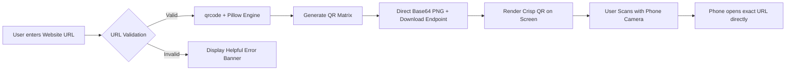

# 📱 Production-Ready Python QR Code Generator

[](https://www.python.org/)
[](https://flask.palletsprojects.com/)
[](#)
[](#)

A modern, high-performance, and privacy-focused **Python QR Code Generator** application built with **Flask**, **Pillow**, and the **`qrcode`** engine.

It accepts **ANY valid website URL/link** and generates an instant, high-resolution QR code encoding the **exact URL** directly without alterations, third-party redirects, or data tracking.

---

## 📑 Table of Contents

- [Key Features](#-key-features)
- [How It Works](#-how-it-works)
- [User Interface Preview](#-user-interface-preview)
- [Project Architecture & Structure](#-project-architecture--structure)
- [Prerequisites](#-prerequisites)
- [Quick Start Guide](#-quick-start-guide)
  - [1. Navigate to Project Folder](#1-navigate-to-project-folder)
  - [2. Create & Activate Virtual Environment](#2-create--activate-virtual-environment)
  - [3. Install Dependencies](#3-install-dependencies)
  - [4. Run the Application](#4-run-the-application)
- [Automated Verification & Tests](#-automated-verification--tests)
- [Technical Specifications](#-technical-specifications)
- [API Reference](#-api-reference)
- [Troubleshooting & FAQ](#-troubleshooting--faq)
- [License](#-license)

---

## 🌟 Key Features

- **Exact & Direct URL Encoding**: Encodes the exact raw URL without shortening, custom redirect servers, or telemetry tracking.
- **Universal Phone Camera Scannability**: Guaranteed 100% compatibility with native camera apps on iOS (iPhone/iPad) and Android, as well as dedicated QR scanner apps.
- **100% Local & Private Generation**: All QR matrices are computed entirely in Python on your local machine using Pillow. No URLs or images are sent to third-party APIs.
- **Preserves Complex URLs**: Correctly encodes special characters, URL query strings, and hash fragments:
  - Example: `https://example.com/product?id=123&utm_source=qr#details`
- **One-Click PNG Download**: Export crisp, high-resolution PNG images named cleanly after the target domain (e.g. `qr_example.com.png`).
- **Interactive Controls**:
  - **Copy URL**: Instant one-click clipboard copy of the encoded destination link.
  - **Clear**: Reset input and output state instantly.
  - **Paste Button**: One-tap paste from clipboard directly into the input field.
  - **Sample Chips**: Quick-test buttons for `example.com`, `google.com`, `instagram.com`, and URLs with query parameters & fragments.
  - **Test Link Button**: Opens the encoded URL in a new tab to verify the destination.
- **Strict & Friendly Validation**: Validates `http://` and `https://` schemas and hostnames, providing clear, actionable feedback if an invalid URL is entered.
- **Unlimited Generations**: Generate as many QR codes as needed during a session without rate limits.

---

## 🎯 How It Works



1. **Input**: Enter or paste any website URL (e.g., `https://example.com/article?ref=web#intro`).
2. **Validation**: Flask backend validates protocol (`http://` or `https://`) and hostname structure.
3. **Generation**: The `qrcode` library generates the matrix with **Error Correction Level M (15%)** and a standard **4-module quiet zone**.
4. **Display & Download**: The QR code is rendered instantly on-screen with the destination URL and a PNG download button.
5. **Scanning**: When scanned by a phone camera, it immediately prompts to open the target website.

---

## 🖥️ User Interface Preview

```text
┌─────────────────────────────────────────────────────────────┐
│                   QR CODE GENERATOR                         │
│   Create high-resolution, phone-scannable QR codes          │
├─────────────────────────────────────────────────────────────┤
│  Enter Website URL                                          │
│  ┌───────────────────────────────────────────────────────┐  │
│  │ 🌐 https://example.com/product?id=123#details       📋│  │
│  └───────────────────────────────────────────────────────┘  │
│  Try sample: [example.com] [google.com] [with params]       │
│                                                             │
│  ┌─────────────────────────┐  ┌──────────────────────────┐  │
│  │   Generate QR Code      │  │          Clear           │  │
│  └─────────────────────────┘  └──────────────────────────┘  │
│                                                             │
│ ──────────────────── GENERATED QR CODE ──────────────────── │
│                                                             │
│                     ┌───────────────┐                       │
│                     │  ██ ███ ███   │                       │
│                     │  ██   █  ██   │                       │
│                     │  ██ ███  ██   │                       │
│                     └───────────────┘                       │
│              ✓ Scannable with any phone camera              │
│                                                             │
│  Encoded Destination URL:                                   │
│  https://example.com/product?id=123#details     [Copy URL]  │
│                                                             │
│  ┌─────────────────────────┐  ┌──────────────────────────┐  │
│  │    📥 Download PNG      │  │       🔗 Test Link       │  │
│  └─────────────────────────┘  └──────────────────────────┘  │
└─────────────────────────────────────────────────────────────┘
```

---

## 📁 Project Architecture & Structure

```text
QR Code Generator/
├── app.py                 # Flask server, validation & QR generation logic
├── requirements.txt       # Project dependencies (Flask, qrcode, pillow, opencv-python)
├── test_app.py            # Automated unit & integration tests with QR decoding
├── templates/
│   └── index.html         # Responsive HTML5 interface
├── static/
│   ├── css/
│   │   └── style.css      # Modern dark/light theme, typography, & animations
│   └── js/
│       └── script.js      # AJAX generation, clipboard helpers, toast notifications
└── README.md              # Comprehensive documentation
```

---

## 💻 Prerequisites

- **Python 3.10 or higher** (Python 3.11, 3.12, and 3.13 are fully supported).
- **pip** package manager.
- Any modern web browser (Chrome, Edge, Firefox, Safari, Brave).

---

## 🚀 Quick Start Guide

### 1. Navigate to Project Folder

Open your terminal (PowerShell or Bash) and navigate into the project directory:

```bash
cd "d:/Work/Coding/Tech and Digital Skills/AI & ML/Python/carzy project idea/QR Code Generator"
```

### 2. Create & Activate Virtual Environment

**On Windows (PowerShell):**
```powershell
python -m venv venv
.\venv\Scripts\Activate.ps1
```

**On Windows (Command Prompt `cmd`):**
```cmd
python -m venv venv
venv\Scripts\activate.bat
```

**On macOS / Linux:**
```bash
python3 -m venv venv
source venv/bin/activate
```

### 3. Install Dependencies

Install all required packages from `requirements.txt`:

```bash
pip install -r requirements.txt
```

### 4. Run the Application

Start the Flask server:

```bash
python app.py
```

You will see output in the terminal:
```text
 * Serving Flask app 'app'
 * Debug mode: on
 * Running on http://127.0.0.1:5000
```

Open your browser and visit:
👉 **[http://127.0.0.1:5000](http://127.0.0.1:5000)**

---

## 🧪 Automated Verification & Tests

The project includes an automated test suite (`test_app.py`) that performs:
1. **URL Validation Tests**: Verifies acceptance of standard URLs, subdomains, query strings, fragments, ports, and localhost.
2. **Invalid URL Rejection**: Confirms rejection of missing protocols, malformed hostnames, and arbitrary text.
3. **Exact Decode Verification with OpenCV**: Uses `cv2.QRCodeDetector` to scan and decode the generated QR codes, verifying character-by-character equality with the original URL.
4. **Download Endpoint Verification**: Tests the binary PNG stream attachment.

To execute the test suite:

```bash
python test_app.py
```

Expected output:
```text
.....
----------------------------------------------------------------------
Ran 5 tests in 0.140s

OK
```

---

## 🔬 Technical Specifications

| Parameter | Value | Rationale |
| :--- | :--- | :--- |
| **Error Correction** | `ERROR_CORRECT_M` (~15%) | Balances high data density with strong resilience against minor smudges or low-light phone scanning. |
| **Quiet Zone (Border)** | `4 modules` | ISO/IEC 18004 QR code standard quiet zone margin to ensure cameras detect pattern edges reliably. |
| **Box Size** | `10 pixels / module` | Produces crisp ~370px to 500px high-resolution images suitable for screens and print. |
| **Color Scheme** | `#000000` on `#FFFFFF` | Pure black on pure white delivers maximum optical contrast for all smartphone cameras. |
| **Encoding** | Exact string bytes (UTF-8) | No URL truncation, no shortening, no redirection services. |

---

## 🔌 API Reference

### 1. Generate QR Code
- **Endpoint**: `POST /generate`
- **Content-Type**: `application/json`
- **Request Body**:
  ```json
  {
    "url": "https://example.com/product?id=123&utm_source=qr#details"
  }
  ```
- **Response (200 OK)**:
  ```json
  {
    "success": true,
    "url": "https://example.com/product?id=123&utm_source=qr#details",
    "qr_image": "data:image/png;base64,iVBORw0KGgo...",
    "filename": "qr_example.com.png"
  }
  ```
- **Response (400 Bad Request)**:
  ```json
  {
    "success": false,
    "error": "URL must start with http:// or https:// (e.g., https://example.com)."
  }
  ```

---

### 2. Direct PNG Download
- **Endpoint**: `GET /download?url=<ENCODED_URL>`
- **Response**: Binary `image/png` stream with `Content-Disposition: attachment; filename="qr_<domain>.png"`.

---

## ❓ Troubleshooting & FAQ

### 1. "URL must start with http:// or https://"
Make sure you include the full protocol. Instead of `example.com`, type `https://example.com`.

### 2. Can my phone scan the QR code directly from my monitor?
Yes! Standard phone camera apps (iOS Camera, Google Lens, Samsung Camera) can scan the QR code right from your screen. Ensure screen brightness is adequate and avoid excessive glare.

### 3. Does this application store or track any URLs?
**No.** All operations are performed locally in-memory on your machine. No databases, third-party tracking, or external logging are used.

### 4. Running in Production
For production deployments, use a production WSGI server such as **Waitress** (on Windows) or **Gunicorn** (on Linux):

```bash
# Windows
pip install waitress
waitress-serve --port=5000 app:app

# Linux / macOS
pip install gunicorn
gunicorn -w 4 -b 0.0.0.0:5000 app:app
```

---

## 📄 License

This project is licensed under the [MIT License](LICENSE). Free for personal and commercial use.
